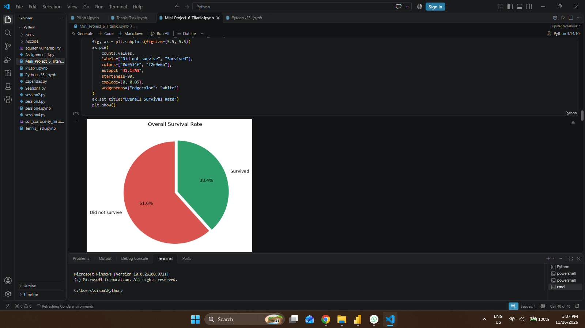
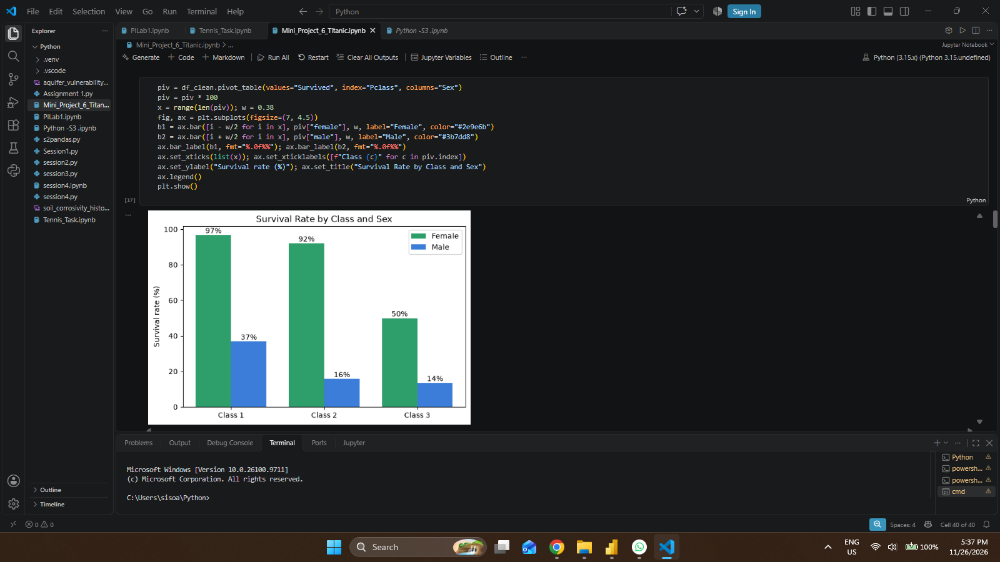
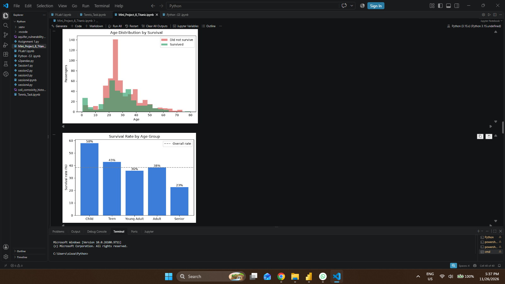
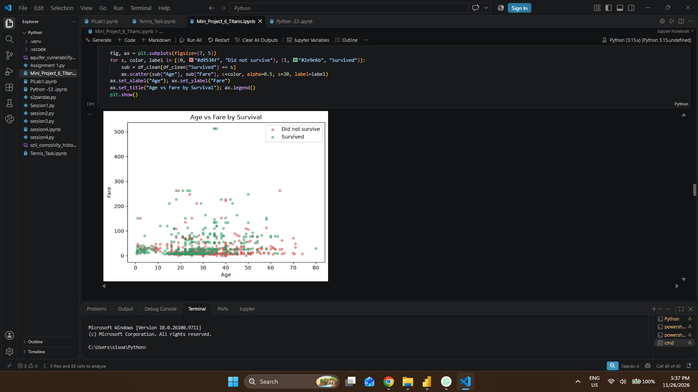
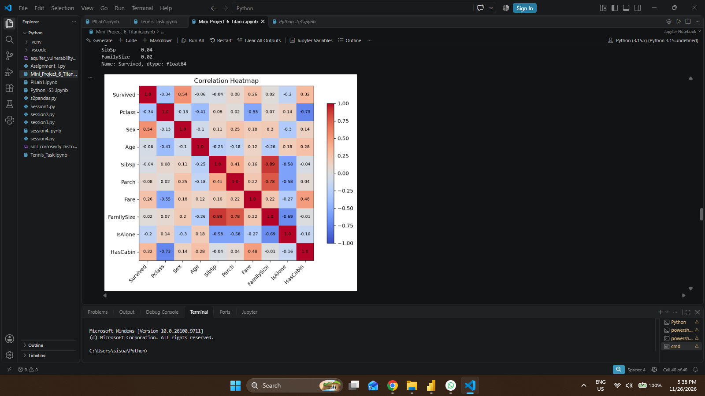
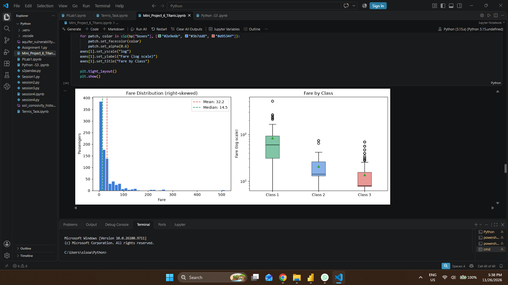
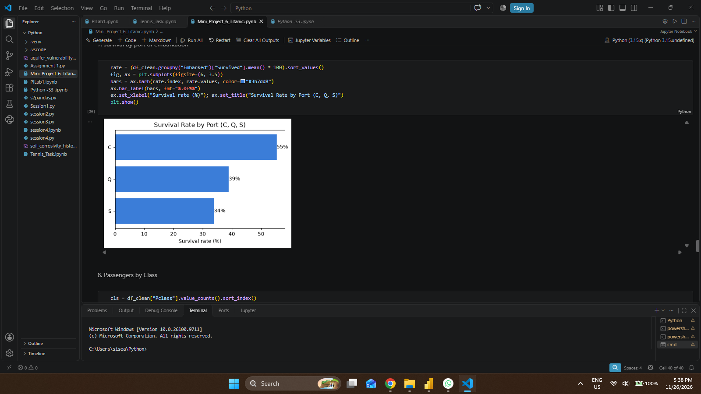
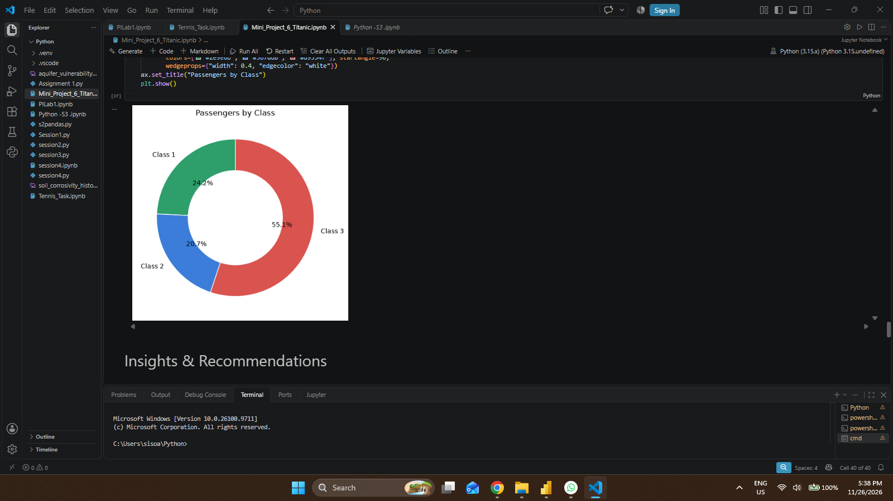

# 🚢 Titanic Passenger Survival Analysis

## 📌 Project Overview

This project uses **Python** to explore and visualize the Titanic passenger dataset.

The main objective is to identify the factors that influenced passenger survival, including sex, ticket class, age, fare, port of embarkation, and family size.

Through data cleaning, statistical analysis, and visualization, the project transforms raw passenger records into meaningful insights and recommendations.

## 🎯 Project Objectives

- Clean the dataset by handling missing values and duplicates.
- Explore survival patterns by sex, class, age, and family size.
- Calculate descriptive statistics and analyze correlations.
- Investigate the relationship between fare, class, and survival.
- Compare survival rates across ports of embarkation.
- Visualize the findings using 8 charts.
- Provide analytical recommendations based on the results.

## 📂 Dataset

The project uses the **Titanic passenger dataset**:

- **891 passengers** and **12 original columns**
- Passenger information (Name, Sex, Age)
- Ticket information (Pclass, Ticket, Fare, Cabin, Embarked)
- Family information (SibSp, Parch)
- Target variable (Survived)

### Missing Values Found

| Column | Missing Values | Percentage |
|:---|---:|---:|
| Cabin | 687 | 77.1% |
| Age | 177 | 19.9% |
| Embarked | 2 | 0.2% |

## 🛠️ Tools & Technologies

- **Python:** Data cleaning, analysis, and visualization.
- **Pandas:** Data manipulation and statistical analysis.
- **Matplotlib:** Chart creation and visualization.
- **Jupyter Notebook:** Development environment and documentation.

---

# 🧹 Data Cleaning

| Column | What Was Done |
|:---|:---|
| PassengerId | Unique identifier. No missing values, no changes. |
| Survived | Target variable (0 = did not survive, 1 = survived). Kept as 0/1. |
| Pclass | Ticket class (1, 2, 3). Values checked and valid. |
| Name | Passenger name. Kept for reference only. |
| Sex | Passenger gender. Values checked (male/female). |
| Age | 177 missing values filled with the median age of each Pclass and Sex group, rounded to whole years. |
| SibSp | Siblings/spouses aboard. No changes. |
| Parch | Parents/children aboard. No changes. |
| Ticket | Ticket number. Kept for reference only. |
| Fare | Ticket price. Kept as float (monetary value). |
| Cabin | 687 missing values (77%) filled with "Other" to avoid inventing cabin numbers. |
| Embarked | 2 missing values filled with the most common port (mode). |
| HasCabin (new) | Yes/No flag created before filling Cabin. |
| FamilySize (new) | SibSp + Parch + 1, total family members aboard including the passenger. |
| IsAlone (new) | 1 if FamilySize equals 1, otherwise 0. |
| AgeGroup (new) | Age grouped into Child, Teen, Young Adult, Adult, and Senior. |

### Cleaning Results

- No duplicates found.
- All missing values handled (Age, Cabin, Embarked).
- 4 new columns created: HasCabin, FamilySize, IsAlone, AgeGroup.
- Final dataset: **891 rows and 16 columns, with 0 missing values**.

---

# 📊 Charts & Visualizations

### 1. Overall Survival

A pie chart showing the share of passengers who survived and did not survive.

### 2. Survival by Sex & Class

A grouped bar chart comparing survival rates of women and men across the three ticket classes.

### 3. Age Analysis

An age distribution histogram split by survival, together with survival rates by age group.

### 4. Age vs Fare

A scatter plot of age and fare, with color representing survival.

### 5. Correlation Analysis

A heatmap showing the correlation between survival and the numeric variables.

### 6. Fare Analysis

A fare distribution histogram with mean and median, alongside a boxplot of fare by class (log scale).

### 7. Survival by Port of Embarkation

A bar chart comparing survival rates for Cherbourg (C), Queenstown (Q), and Southampton (S).

### 8. Passengers by Class

A donut chart showing the distribution of passengers across the three classes.

---

# 🔍 Key Insights

- **Overall Survival:** Only **38.4%** of passengers survived (342 survived, 549 did not).
- **Sex:** The strongest factor. Women survived at **74.2%** vs **18.9%** for men.
- **Class:** Survival was **63.0%** in 1st class, **47.3%** in 2nd, and **24.2%** in 3rd. Women in 1st and 2nd class survived at 96.8% and 92.1%, but 3rd-class women only at 50.0%.
- **Age:** Children (12 and under) had the highest survival rate at **58.0%**, while seniors had the lowest at 22.7%. Age alone has a weak effect (correlation -0.06).
- **Fare:** Survivors paid a much higher average fare (48.40) than non-survivors (22.12). Of the 20 passengers who paid over 200, 70% survived.
- **Fare Distribution:** Strongly right-skewed (skewness 4.79). Mean is 32.20 vs median 14.45. 116 outliers were kept because they are real first-class tickets.
- **Port:** Cherbourg had the highest survival (**55.4%**) vs Queenstown (39.0%) and Southampton (33.9%). Class explains much of this, but not all.
- **Passenger Classes:** 3rd class was the majority (**55.1%**) and had the lowest survival, which explains the low overall rate.
- **Correlation:** Sex (+0.54) and Pclass (-0.34) are the strongest correlations with survival. HasCabin (+0.32) and Fare (+0.26) are moderate. IsAlone is weakly negative (-0.20): solo travellers survived at 30.4% vs 50.6% for those with family.

## 🏁 Overall Conclusion

Survival followed a clear pattern: **women, first-class passengers, and higher-paying passengers were much more likely to survive**. Sex was the strongest single factor and class was second. Children also had an advantage. Port and family status had smaller effects, and several of them are partly explained by class.

## 💡 Recommendations

1. **Equal evacuation access:** Emergency routes, signage, and boat access should serve every deck and ticket class equally.
2. **Protect the most at-risk group:** 3rd-class men survived at only 13.5%, so safety planning should include assigned crew assistance for lower-class passengers.
3. **Support vulnerable passengers:** Travellers who are alone and the elderly need dedicated help during evacuation.
4. **Base procedures on need, not on sex or status:** "Women and children first" helped many, but most men had little chance, especially in 2nd and 3rd class.
5. **Improve data collection:** Age was missing for 19.9% of passengers and Cabin for 77.1%. Complete records would give more reliable safety analysis.
6. **Next analytical step:** Build a predictive model (such as logistic regression or a decision tree) using Sex, Pclass, Fare, and Age.

---

# 🔎 Key Analytical Areas

- **Data Cleaning:** Handling missing values, duplicates, and feature engineering.
- **Demographic Analysis:** Survival by sex, age group, and family size.
- **Economic Analysis:** Relationship between fare, ticket class, and survival.
- **Geographical Analysis:** Survival differences by port of embarkation.
- **Correlation Analysis:** Exploring relationships between variables and survival.

## 🎓 Skills Demonstrated

- Python Programming
- Data Cleaning & Preprocessing
- Feature Engineering
- Exploratory Data Analysis (EDA)
- Pandas (groupby, pivot tables, cut)
- Data Visualization with Matplotlib
- Correlation Analysis
- Descriptive Statistics
- Analytical Reporting & Recommendations
